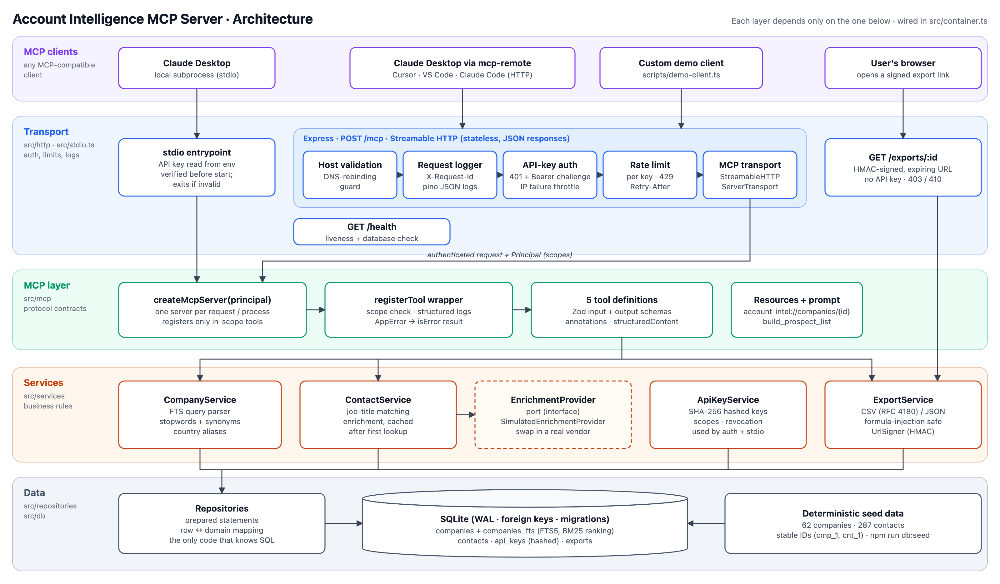
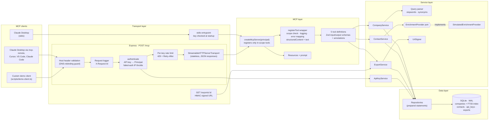
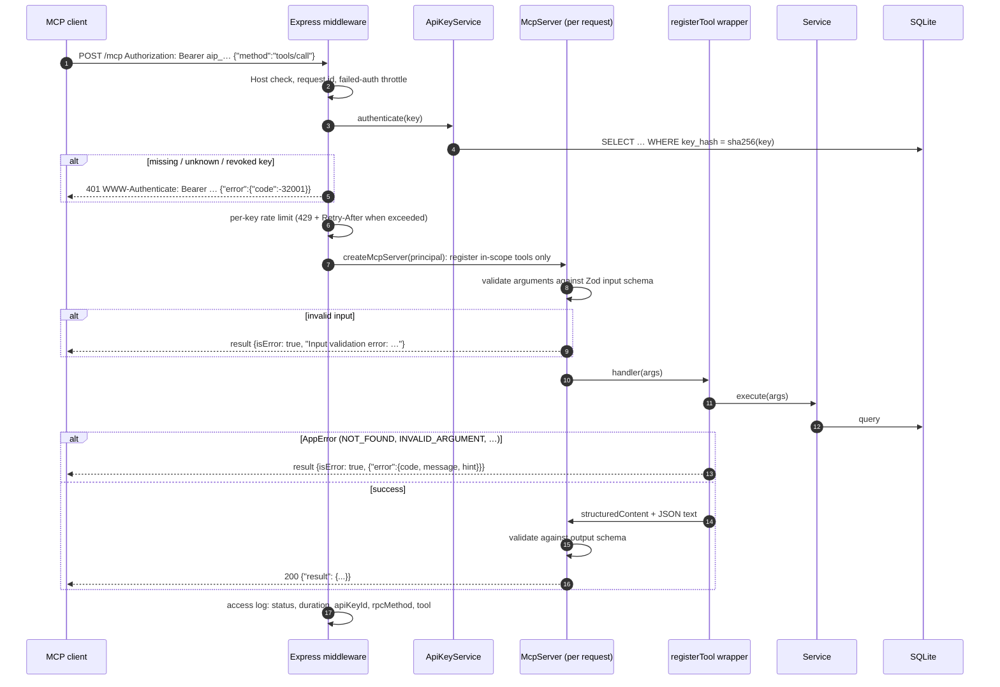

# Architecture

The server is a layered TypeScript application. Each layer depends only on the layer beneath it, and the
composition root ([`src/container.ts`](../src/container.ts)) is the only module that knows how they are wired.



## Component view



| Layer | Responsibility | Key files |
| --- | --- | --- |
| Transport | Wire protocol, authentication, rate limiting, logging. Knows nothing about companies. | `src/http/**`, `src/stdio.ts` |
| MCP | Tool contracts (schemas, descriptions, annotations), discovery filtering, translating results and errors into MCP results. | `src/mcp/**` |
| Services | Business rules: search relevance, country aliases, enrichment caching, export validation, key lifecycle. Throw typed `AppError`s. | `src/services/**`, `src/auth/apiKeyService.ts` |
| Data | SQL only. Maps rows to domain types. | `src/repositories/**`, `src/db/**` |

## Request lifecycle: `tools/call` over HTTP



## Export and download flow

```mermaid
sequenceDiagram
  participant C as MCP client
  participant X as ExportService
  participant D as SQLite
  participant U as User's browser

  C->>X: export_contacts {contactIds}
  X->>D: load contacts + companies (all IDs must exist)
  X->>X: render CSV/JSON (RFC 4180, formula-injection safe)
  X->>D: INSERT exports (content, expires_at); purge expired
  X-->>C: downloadUrl = /exports/exp_…?expires=…&signature=HMAC(path, expires)
  C-->>U: shares the link
  U->>X: GET /exports/exp_…?expires&signature (no API key)
  X->>X: constant-time signature check, expiry check
  X-->>U: 200 attachment (or 403 bad signature / 410 expired)
```

## Design decisions

**Stateless Streamable HTTP.** Each `POST /mcp` builds a fresh `McpServer` bound to the caller's principal and
discards it when the response closes. There are no MCP sessions to store or pin, so replicas can sit behind a plain load
balancer. Building the server per request costs microseconds (five tool registrations). `GET`/`DELETE /mcp` return
`405`, because there is no server-initiated stream or session to end. JSON responses (`enableJsonResponse`) keep the
endpoint easy to call from curl.

**Scope-filtered discovery.** The tools a key cannot use are never registered for that request, so `tools/list` only
shows callable tools and the model is not tempted to call tools it cannot use. The wrapper still checks the scope before
executing, as defence in depth.

**Two error channels, used deliberately.** HTTP and JSON-RPC errors are for failures the model cannot fix: bad
credentials (401), throttling (429), malformed JSON (400 / -32700). Problems the model *can* fix, such as an unknown ID,
an invalid country or a malformed argument, come back as tool results with `isError: true`. The JSON body includes a
`hint` that names the tool to call next. Unexpected exceptions are logged with their stack and returned as a generic
`INTERNAL` error, so internals never leak.

**One schema, three uses.** Each tool's Zod schemas provide runtime validation, the JSON Schema that clients receive in
`tools/list`, and the TypeScript types of the `execute` function. Output schemas are enforced by the SDK, so a tool cannot
drift from its documented contract, and `docs/TOOLS.md` is generated from the same definitions.

**Search.** Company search uses an SQLite FTS5 index (porter stemming, BM25 with per-column weights; a match in the name
outweighs one in the description). A small parser drops conversational filler ("companies", "in", "find") and expands
shorthand ("AI" becomes AI, artificial intelligence, machine learning or LLM). It first requires every term to match,
then relaxes to any term if that finds nothing. All tokens are quoted before they reach FTS5, so user input cannot inject
query syntax.

**Enrichment behind a port.** `ContactService` depends on the `EnrichmentProvider` interface. The bundled provider is
deterministic, with realistic partial match rates, and supporting a real vendor means adding one class in the composition
root. Results are persisted, so repeat calls are free (`cached: true`) and the tool is idempotent.

**Exports as presigned links.** A download URL authorises exactly one file until it expires, using an HMAC over the path
and expiry, and needs no API key. Files live in SQLite to keep the project self-contained. In production they would go to
object storage, using that store's presigned URLs.

**API keys.** Keys are 192-bit random secrets prefixed `aip_`. Only a SHA-256 digest is stored: for high-entropy secrets
a fast hash is sufficient, and slow password hashes would only add latency to every request. Keys carry scopes, can be
revoked, and record `last_used_at`. Failed attempts are throttled per IP: only failures count, so a valid client's burst
of traffic is never mistaken for brute force.

## Scaling beyond one instance

| Concern | Today | Production swap |
| --- | --- | --- |
| Database | SQLite file (WAL) | PostgreSQL. Repositories are the only SQL; FTS5 maps to `tsvector` / `pg_trgm`. |
| Rate-limit counters | In-memory | Shared store, e.g. `rate-limit-redis` (express-rate-limit store interface) |
| Failed-auth counters | In-memory | Redis, or the WAF / API gateway |
| Export files | SQLite BLOB | S3/GCS + native presigned URLs |
| Enrichment | Simulated provider | Vendor implementation of `EnrichmentProvider` + a credit ledger per key |
| Auth | API keys | OAuth 2.1 + PKCE via the SDK's `mcpAuthRouter` / `requireBearerAuth`; scopes map 1:1 |
